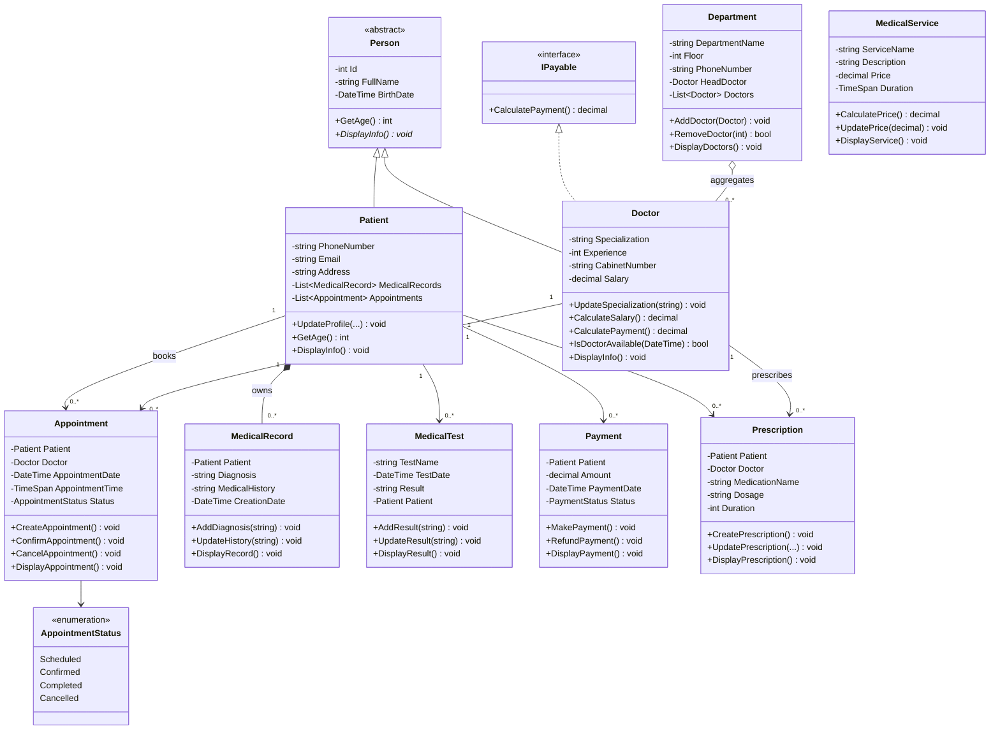

# Медицинский портал — модель классов и изменения

## UML

## Краткий отчёт

- В проекте сохранён ASP.NET Core MVC и добавлен консольный режим запуска `dotnet run -- --console` с меню 1–12 и пунктом 0 для выхода.
- Добавлены сущности пациента, врача, отделения, услуги, приёма, медицинской карты, анализа, платежа и рецепта. `Person` является абстрактным базовым классом; `Doctor` реализует `IPayable`; статусы приёмов ограничены `AppointmentStatus`.
- Сервис портала выполняет поиск пациентов по ID/ФИО/телефону, проверяет конфликты расписания по врачу, дате и времени и агрегирует статистику.
- `Department` хранит ссылки на врачей, не владея их жизненным циклом (агрегация). `Patient` владеет списком медицинских карт; карта создаётся для пациента и регистрируется у него (композиция).
- Данные хранятся в памяти процесса; SQLite не добавлялась, так как для поставленных сценариев постоянное хранение не было обязательным.
